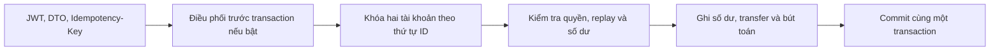

# Kiểm soát tải chuyển khoản

[Kết quả đối chiếu](REPORT.md) · [Quy trình CI](../../../.github/workflows/ci.yml)

API chuyển khoản giữ nguyên tên endpoint, kiểu dữ liệu và quy tắc idempotency. Khoản chuyển mới trả HTTP 201, yêu cầu gửi lại cùng khóa và nội dung trả HTTP 200, còn trùng khóa nhưng khác nội dung trả HTTP 409.

| Cấu hình | Ý nghĩa |
|---|---|
| `TRANSFER_COMPACT_WRITE` | Mặc định `on`, gộp cập nhật hai số dư, tạo transfer và ghi hai bút toán vào một lệnh SQL. `off` dùng ba lệnh ghi. |
| `TRANSFER_ADMISSION` | `off` để PostgreSQL điều phối khóa. `global` dùng một hàng đợi FIFO cho cả tiến trình API. `account` xếp thứ tự theo cùng ID nguồn hoặc cùng số tài khoản đích và cho các yêu cầu độc lập chạy song song. |
| `TRANSFER_ACTIVE_LIMIT` | Số lệnh chuyển khoản được bắt đầu đồng thời khi hàng đợi bật. Giá trị mặc định 8. |
| `TRANSFER_QUEUE_LIMIT` | Số yêu cầu được chờ trong mỗi tiến trình. Mặc định 128. Giá trị 0 từ chối ngay khi hết chỗ chạy. |
| `TRANSFER_QUEUE_WAIT_MS` | Giới hạn chờ vào hàng đợi theo mili giây. Mặc định 3000. Thời gian thực thi và thử lại transaction được tính riêng. |

Hàng đợi đầy hoặc hết thời gian chờ trả HTTP 503 với mã `TRANSFER_OVERLOADED`. Client thử lại có giãn cách bằng cùng `Idempotency-Key` và nội dung. Request rời kết nối trước khi được nhận sẽ được bỏ khỏi hàng đợi. Transaction đã chạy kết thúc theo quy tắc commit hoặc rollback hiện hành.

Hàng đợi chỉ điều phối trong một tiến trình API. Khóa nguồn và đích thuộc hai không gian khóa, nên chuyển A→B và B→A vẫn có thể vào transaction đồng thời. Mọi trường hợp, gồm nhiều tiến trình API hoặc chuyển khoản đồng thời với nạp/rút, vẫn dựa vào khóa PostgreSQL theo thứ tự ID và ràng buộc database. Bản ghi tiền và bút toán vẫn commit nguyên tử. Lệnh SQL gộp sử dụng tham số qua Prisma và xác nhận đủ hai dòng số dư cùng hai bút toán trước khi trả kết quả.

## Chạy lại đánh giá

1. Dùng Node 24.22.3, `npm ci` và PostgreSQL 15.19 dành riêng cho thử nghiệm. Tên database thử nghiệm phải kết thúc bằng `_test`. Bật `pg_stat_statements` trong `shared_preload_libraries` và khởi động lại instance thử nghiệm.
2. Đặt `DATABASE_URL` cho database thử nghiệm và chạy `npx prisma generate`, `npx prisma migrate deploy`, `npm run build`.
3. Đặt các biến dưới đây rồi chạy `node scripts/phase2/benchmark-followup.cjs`. Với PowerShell, đặt biến bằng `$env:TEN_BIEN='gia-tri'`.

| Biến | Giá trị cho phép đo chính thức |
|---|---|
| `TRANSFER_PROFILES` | `baseline,compact`. Các giá trị hỗ trợ thêm gồm `global,account,combined`. |
| `SCENARIOS` | `transfer_hot_10,transfer_hot_50,transfer_hot_100,transfer_distributed_10` |
| `ROUNDS` | `5` |
| `DURATION` | `60` |
| `OUTPUT` | Thư mục riêng cho lần đo |

Tổng hợp bằng `node scripts/phase2/summarize-contention.cjs <OUTPUT> <phương án chọn>`. Dữ liệu gốc lưu thời gian chờ, tổng transaction, lỗi theo mã và đối soát từng lượt. Để vẽ hình, chạy `python scripts/phase2/plot.py --results <OUTPUT> --title "SA BankAccount | Transfer contention"`.

Chạy kiểm thử bằng `node scripts/phase2/verify.cjs` với `SKIP_HISTORICAL_COMPARISON=1` và `OUTPUT` là thư mục kiểm thử mới. Bài kiểm tra so với phiên bản giai đoạn 1 đòi hỏi build cũ và có thể chạy riêng nếu đã chuẩn bị `.phase2/baseline-dist`.
