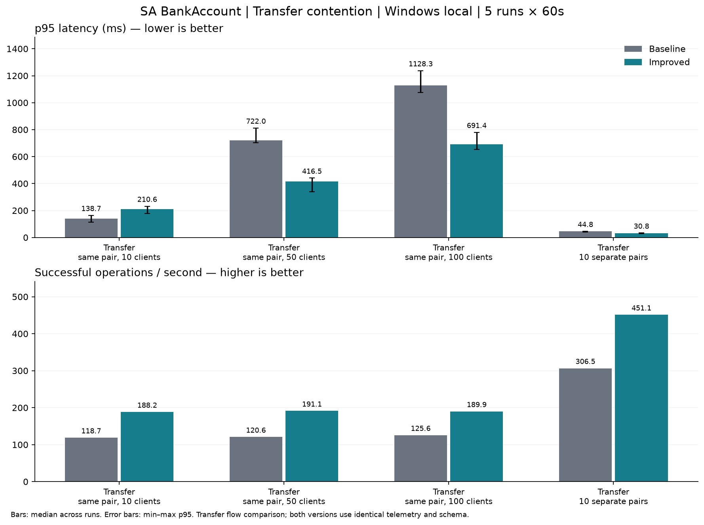

# Báo cáo kết quả cải tiến SA_BankAccount — Giai đoạn 2

Với 50 client chuyển trên cùng cặp tài khoản, **p95 giảm từ 722,04 xuống 416,51 ms** và **thông lượng tăng từ 120,63 lên 191,15 giao dịch thành công/giây**. Cả năm lượt ghi gộp đều đạt p95 dưới 500 ms và thông lượng trên 158 giao dịch/giây.

Bản tối ưu gộp cập nhật hai số dư, tạo giao dịch và ghi hai bút toán vào một câu SQL. Kiểm tra quyền sở hữu, số dư, trạng thái, idempotency và thứ tự khóa được thực hiện trước khi ghi. Nếu câu SQL gặp lỗi, transaction rollback toàn bộ. Cách ghi gộp được chọn làm mặc định sau đợt sàng lọc, với `TRANSFER_COMPACT_WRITE=off` để quay lại cách ghi cũ khi cần.

## Hạng mục đã hoàn thành

| Hạng mục | Thay đổi đã thực hiện | Kết quả kiểm chứng |
|---|---|---|
| Tối ưu truy vấn lịch sử | Bổ sung API duyệt bằng cursor, dùng chỉ mục hiện có và lấy thêm một dòng để xác định còn trang tiếp. API phân trang theo số trang vẫn được hỗ trợ. | Trên Kaggle CPU, p95 khi đọc cùng 20 giao dịch ở trang sâu trong lịch sử 300.000 bản ghi giảm từ 591,60 xuống 16,94 ms. API cursor phục vụ duyệt tuần tự và chỉ báo còn trang tiếp. [Báo cáo Kaggle](../phase2/kaggle/REPORT.md) |
| Chống ghi tiền trùng | Chuyển khoản phát hiện key bị dùng lại với nội dung khác. Nạp/rút nhận `Idempotency-Key` tùy chọn. Các lần gửi lại cùng key và nội dung trả kết quả đã lưu. | Kiểm thử đồng thời, xung đột trả HTTP 409 và mất kết nối sau commit đều đạt. Số dư và bút toán chỉ thay đổi một lần khi dùng cùng key. [Báo cáo nạp/rút](../phase2-followup/REPORT.md) |
| Bảo toàn giao dịch khi tranh chấp | Khóa hai tài khoản theo thứ tự ID trong một truy vấn. Giữ số dư, giao dịch và bút toán trong cùng transaction. Thử lại tối đa một lần với lỗi xác nhận transaction đã bị hủy. | Kiểm thử chuyển chéo, chống thấu chi và rollback khi phần ghi thất bại đều đạt trên PostgreSQL thật. [Kiểm thử](validation/validation.txt) |
| Đo điểm nghẽn | Bổ sung đo thời gian bắt đầu transaction, truy vấn khóa, ghi dữ liệu và số lần retry. Lấy mẫu phiên chờ khóa ở PostgreSQL trong phép đo tải. | Thời gian ghi ở 50 client giảm từ 4,38 xuống 1,58 ms mỗi lần thử. Khoảng 8 phiên vẫn chờ khóa ở cả hai phiên bản, cho thấy tranh chấp còn tồn tại. [Số liệu từng lượt](results/runs.json) |
| Tối ưu ghi khi tải cao | So sánh năm cấu hình, gồm giới hạn đồng thời, xếp hàng theo tài khoản, ghi gộp và kết hợp. Chọn ghi gộp làm mặc định và cung cấp tùy chọn hàng đợi có giới hạn. | Đo 40 lượt chính thức qua bốn kịch bản, tổng cộng 513.094 request. Cả 40 lượt đối soát đúng số dư và bút toán. Năm phản hồi lỗi đều thuộc bản mốc. [Kết quả chính thức](#kết-quả-chính-thức) |
| Cập nhật dependency và tự động hóa kiểm thử | Cập nhật lockfile. Thêm workflow CI cho build, unit test, PostgreSQL, API HTTP, Swagger, audit runtime và Docker. | Audit runtime giảm từ 9 mục xuống 0 tại thời điểm đo. Bản cuối đạt 262 ca kiểm thử và Docker smoke test. Workflow đã được kiểm tra tại máy, chờ nhánh được đẩy lên để chạy trên GitHub Actions. [Audit sau cập nhật](audit/audit-after.json) · [Workflow CI](../../../.github/workflows/ci.yml) |

Số liệu Kaggle và số liệu ở từng đợt tại máy dùng các bản mốc và quy trình đo riêng. Mỗi mức thay đổi trong báo cáo được tính từ hai cấu hình chạy trong cùng đợt. [Đợt đầu tại máy](../phase2/REPORT.md) · [Đợt bổ sung đo và idempotency](../phase2-followup/REPORT.md)

## Rà soát dependency

Các bản vá trong phạm vi phiên bản đã khai báo được cập nhật trong lockfile, tiêu biểu là `@nestjs/platform-express` 12.1.2 → 12.5.1, Express 5.2.1 → 5.3.0 và Prisma CLI 7.10.0 → 7.10.1. Kết quả `npm audit --omit=dev` tại thời điểm đánh giá giảm từ **9 mục (7 high, 2 moderate) xuống 0**. Audit toàn cây còn **51 mục ở dependency phát triển** trên máy Windows (47 high, 4 moderate, 0 critical), chủ yếu từ chuỗi Jest, Nest CLI và các thư viện glob. Các bản sửa mà npm đề xuất qua `--force` cần được đánh giá cùng khả năng tương thích của bộ công cụ kiểm thử. [Audit trước](audit/audit-before.json) · [Audit runtime sau](audit/audit-after.json) · [Audit toàn cây sau](audit/audit-development-after.json) · [Tài liệu npm audit](https://docs.npmjs.com/cli/v11/commands/npm-audit/).

## Sàng lọc các phương án

Mỗi cấu hình được đo hai lượt × 4 giây cho mỗi kịch bản, có warm-up 2 giây. Cả năm cấu hình dùng chung dependency, PostgreSQL và telemetry. Dưới đây là kịch bản 50 client trên một cặp tài khoản. Các con số là trung vị của từng lượt.

| Phương án | p95 (ms) | Chuyển thành công/giây |
|---|---:|---:|
| Ba lệnh ghi, điều phối tại PostgreSQL | 770,2 | 118,9 |
| Giới hạn 8 yêu cầu chạy, FIFO chung | 597,1 | 123,4 |
| Giới hạn 8 yêu cầu chạy, xếp hàng theo nguồn hoặc đích | 545,0 | 95,1 |
| Gộp ghi | **365,5** | **198,9** |
| Gộp ghi và xếp hàng theo tài khoản | 423,3 | 130,9 |

Xếp hàng theo tài khoản giảm số phiên chờ khóa xuống gần 0 trong kịch bản cùng cặp. Phần chờ chuyển sang trước transaction, còn thông lượng giảm so với gộp ghi đơn thuần. Cấu hình gộp ghi được chọn để kiểm tra dài hơn. Chế độ hàng đợi vẫn có thể bật nếu cần giới hạn số request chờ và số transaction hoạt động. [Kết quả sàng lọc đầy đủ](screening/profiles-summary.json) · [Tài liệu PostgreSQL về khóa](https://www.postgresql.org/docs/15/explicit-locking.html).

## Cách đánh giá chính thức

Chạy tuần tự trên cùng máy Windows, Node 24.22.3 và PostgreSQL 15.19 trong Docker. Cả hai cấu hình dùng cùng binary Node, mã build, schema, dependency và telemetry. Cấu hình mốc tắt gộp ghi và hàng đợi. Cấu hình được chọn chỉ bật gộp ghi. Đo 5 lượt × 60 giây cho mỗi cấu hình và kịch bản. Đảo thứ tự hai cấu hình giữa các vòng. Kịch bản gồm 10, 50 và 100 client cùng cặp; kịch bản phân tán dùng 10 cặp độc lập.

Mỗi client gửi yêu cầu kế tiếp khi nhận xong yêu cầu trước. Số liệu tính từ lần gửi đến khi nhận và đọc phản hồi. Mỗi lượt lưu cả phần trăm vị độ trễ toàn bộ phản hồi và của riêng giao dịch thành công, thông lượng thành công, lỗi, retry và số phiên chờ khóa lấy mẫu. Sau từng lượt, kiểm tra tổng số dư, số transfer, hai bút toán mỗi transfer và tổng bút toán theo từng tài khoản.

Bộ đo ban đầu dừng khi PostgreSQL có 7.195 giao dịch nhưng chỉ 7.194 phản hồi HTTP thành công. Một request chạm timeout 15 giây phía client và số ghi sổ nhiều hơn số client nhận được. Phiên đo chính thức dùng timeout client 45 giây cho cả hai bản, đối chiếu giao dịch theo idempotency key và đếm riêng commit chưa có xác nhận HTTP. Lỗi HTTP vẫn tính vào tỷ lệ lỗi và độ trễ toàn bộ, còn thông lượng thành công chỉ tính phản hồi 201 đã kiểm tra. [Lượt đo ban đầu](interrupted-timeout/runs.json).

## Kết quả chính thức

Số liệu dưới đây là trung vị của năm lượt cho từng cấu hình. p50, p95 và p99 tính theo mili giây trên toàn bộ phản hồi. Thông lượng tính theo giao dịch thành công/giây.

| Kịch bản | p50 trước → sau | p95 trước → sau | p99 trước → sau | Thông lượng trước → sau |
|---|---:|---:|---:|---:|
| 10 client, cùng cặp | 24,90 → 19,54 | 138,70 → 210,61 | 1.161,93 → 323,01 | 118,75 → 188,18 |
| 50 client, cùng cặp | 362,54 → 253,11 | **722,04 → 416,51** | 992,30 → 492,41 | **120,63 → 191,15** |
| 100 client, cùng cặp | 734,28 → 514,08 | 1.128,28 → 691,37 | 1.392,02 → 825,82 | 125,61 → 189,89 |
| 10 cặp độc lập | 31,13 → 20,64 | 44,82 → 30,85 | 52,71 → 38,33 | 306,54 → 451,07 |

- **50 client.** p95 giảm 42,32%, p99 giảm 50,38% và thông lượng tăng 58,46%. Khoảng p95 qua các lượt giảm từ 703–812 ms xuống 340–441 ms.
- **10 client cùng cặp.** p95 tăng 51,84% dù p99 giảm 72,20% và thông lượng tăng 58,47%. Tất cả năm lượt ghi gộp có p95 cao hơn năm lượt mốc. Đây là sự đánh đổi ở tải này.
- **100 client.** Phần đuôi vẫn cao, với p95 khoảng 691 ms và p99 khoảng 826 ms sau cải tiến.
- **Đối soát.** 513.094 request trên 40 lượt. Cả năm lỗi `503 TRANSACTION_BUSY` đều xảy ra ở bản mốc tại tải 10 client. Bản ghi gộp có 0 lỗi được quan sát. 40/40 lượt đối soát đúng, không phát hiện commit thiếu xác nhận trong bộ đo chính thức. Bản mốc thực hiện 75 lần retry, bản ghi gộp không phát sinh retry trong bộ đo.

## Phần nào của transaction thay đổi

| Tải cùng cặp | Bắt đầu transaction (ms/lần thử) | Truy vấn khóa (ms/lần thử) | Ghi dữ liệu (ms/lần thử) | Phiên chờ khóa trung bình |
|---|---:|---:|---:|---:|
| 10 client | 1,04 → 1,02 | 71,71 → 44,06 | 4,50 → 1,64 | 8,05 → 7,95 |
| 50 client | 329,26 → 207,86 | 72,53 → 45,14 | 4,38 → 1,58 | 8,10 → 8,01 |
| 100 client | 710,89 → 470,91 | 69,65 → 45,38 | 4,22 → 1,58 | 8,08 → 8,02 |

Mỗi ô là trung vị của giá trị trung bình trong năm lượt. Thời gian bắt đầu transaction gồm lấy kết nối, BEGIN và chi phí Prisma. Truy vấn khóa gồm cả thực thi SQL lẫn chờ khóa, còn số phiên đợi lấy mẫu mỗi khoảng 50 ms. Kết quả phù hợp với việc rút ngắn phần ghi giúp giải phóng khóa sớm hơn, nhưng các request vẫn phải chờ khi tranh chấp. Phép đo sử dụng một tiến trình API, một PostgreSQL và dữ liệu thử nghiệm trên cùng máy.

Thử riêng `SET LOCAL lock_timeout = '100ms'` khi một kết nối khác đang khóa dòng tài khoản. PostgreSQL trả `55P03` sau khoảng 103 ms và thiết lập trở về 0 sau rollback. Bản được chọn giữ cấu hình khóa hiện tại vì timeout này sẽ chuyển thời gian chờ thành lỗi nếu không có chính sách xử lý và đo lại đầy đủ. [Bằng chứng thử timeout](validation/lock-timeout.json) · [Tài liệu lock_timeout](https://www.postgresql.org/docs/15/runtime-config-client.html#GUC-LOCK-TIMEOUT).

[Số liệu từng lượt](results/runs.json) · [Môi trường và cấu hình](results/environment.json) · [Tổng hợp đầy đủ](results/profiles-summary.json)

## Kiểm chứng

**262 ca kiểm thử đạt** (172 unit, 46 integration PostgreSQL và 44 HTTP/persistence/retry/telemetry/queue). Swagger đủ 10 operation, Prisma xác nhận schema khớp migration, Docker build và smoke test ghi gộp cùng hàng đợi đạt. Workflow chạy các bước này và audit dependency runtime, rồi lưu đầu ra làm artifact. Đã kiểm tra workflow bằng actionlint 1.7.12 và chạy các bước tại máy. GitHub Actions sẽ thực thi khi nhánh được đẩy lên. [Kết quả kiểm thử](validation/validation.txt) · [Docker](validation/docker-smoke.json).

## Kết luận nghiệm thu

Bản cải tiến **đạt tiêu chí nghiệm thu ở 50 client cùng chuyển trên một cặp tài khoản trong môi trường thử nghiệm**. Cả năm lượt của bản ghi gộp đều đạt p95 dưới 500 ms, trên 158 giao dịch thành công/giây, không ghi nhận lỗi và đối soát đúng.

Ở 100 client cùng cặp, thông lượng gần như giữ ở 190 giao dịch/giây trong khi p95 tăng từ khoảng 417 lên 691 ms so với 50 client. Đây là dấu hiệu bão hòa của luồng chuyển cùng cặp trong cấu hình đã đo. Kịch bản 10 client cùng cặp cũng có đánh đổi riêng khi p95 cao hơn bản mốc dù p99 và thông lượng cải thiện. Độ ổn định khi chạy liên tục nhiều giờ hoặc triển khai nhiều tiến trình API vẫn cần được kiểm chứng. Audit cây dependency phát triển còn 51 mục tại thời điểm đánh giá.

[Hướng dẫn cấu hình và chạy lại](README.md)
