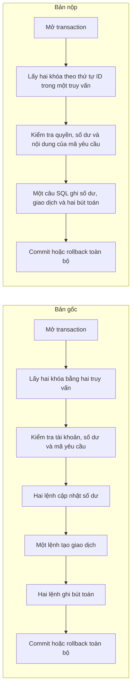

# Luồng chuyển khoản trước và sau cải tiến

Cả hai bản dùng ứng dụng NestJS phân module và PostgreSQL. Luồng bên dưới bắt đầu khi API đã xác thực yêu cầu. Khóa tài khoản theo cùng một thứ tự để hai giao dịch chuyển chéo không lần lượt giữ hai khóa ngược nhau.

Tại tải cao trên cùng cặp tài khoản, các request ghi phải chờ transaction đang giữ khóa. Gộp năm lệnh ghi thành một câu SQL giảm lượt trao đổi giữa ứng dụng và PostgreSQL trong lúc giữ khóa. Kiểm tra số lượng dòng ghi cùng các ràng buộc database giúp bảo đảm mọi thay đổi của một lần chuyển cùng được xác nhận hoặc cùng được hoàn tác.

Khi client gửi lại một lệnh sau khi mất phản hồi, hệ thống trả kết quả đã ghi nếu mã yêu cầu và nội dung khớp. Cơ chế này áp dụng cho chuyển khoản và cho nạp/rút khi client cung cấp mã. Tùy chọn hàng đợi tại API có thể giới hạn request chờ trước transaction.

| Đọc lịch sử | Bản gốc | Bản nộp |
|---|---|---|
| Đi đến trang kế tiếp | Bỏ qua các dòng trước bằng OFFSET rồi đếm tổng số dòng | Tìm từ vị trí của giao dịch cuối trang bằng chỉ mục |
| Thông tin trả về | Tổng số dòng và số trang | Có trang kế tiếp và cursor để duyệt tuần tự |

[Thiết kế và đánh giá các đợt trước](../phase2-contention/REPORT.md)
