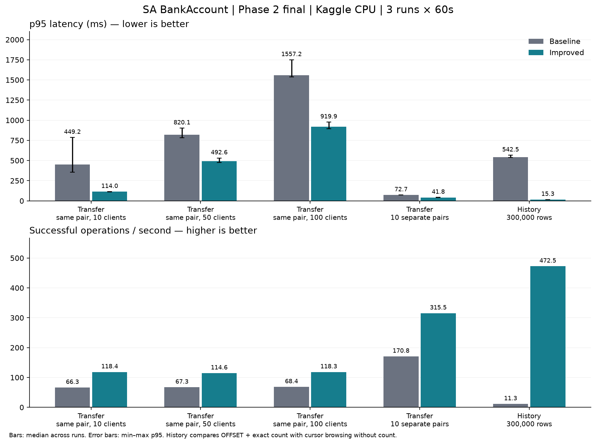

# Kết quả chính thức Pha 2 trên Kaggle CPU

So với bản gốc, ở tải 50 client cùng chuyển trên một cặp tài khoản, p95 **giảm 39,93%** và thông lượng **tăng 70,41%**. Với trang sâu trong lịch sử 300.000 giao dịch, p95 **giảm 97,19%**.

[Thiết kế trước–sau](ARCHITECTURE.md) · [Notebook để chạy lại](kaggle-final.ipynb) · [Dữ liệu gốc từ Kaggle](kaggle-output-original.zip)

## Thiết kế phép đo

- Mã bản gốc `c347c921d77ba533cfacd8e180feccef720be013`. Mã bản nộp `bf78c1e17f4b89e661ea5c28dfa99f60afab47f4`. Hai bản dùng cùng phiên Kaggle CPU, cùng Node, PostgreSQL, thư viện và schema thử nghiệm.
- Phần cứng Intel(R) Xeon(R) CPU @ 2.20GHz, 4 luồng logic, RAM 31,3 GiB. Node v24.22.3. PostgreSQL 16.15 (Ubuntu 16.15-0ubuntu0.24.04.1) on x86_64-pc-linux-gnu, compiled by gcc (Ubuntu 13.3.0-6ubuntu2~24.04.1) 13.3.0, 64-bit.
- Mỗi cấu hình chạy ba lượt × 60 giây cho từng kịch bản, với warm-up hai giây. Đảo thứ tự hai cấu hình giữa các vòng. Client gửi request kế tiếp sau khi nhận kết quả của request trước.
- Bản cuối bật ghi gộp và tắt hàng đợi API. Đo thời gian đầu cuối qua HTTP, gồm thời gian đọc JSON và kiểm tra kết quả. p50/p95/p99 của bảng là trung vị của ba lượt, tính cả phản hồi lỗi.
- Phép đo lịch sử kiểm tra hai bản trả về cùng 20 ID. Bản gốc dùng OFFSET và COUNT, còn bản cuối dùng cursor đã biết. Kết quả đo lợi ích khi duyệt tuần tự với cursor; chi phí tìm cursor ban đầu nằm ngoài lượt đo này.

## Kết quả trước → sau

| Kịch bản | p50 (ms) | p95 (ms) | p99 (ms) | Thành công/giây | Lỗi trước → sau |
|---|---:|---:|---:|---:|---:|
| 10 client, cùng cặp | 69,17 → 27,20 | 449,23 → 113,96 | 620,10 → 1.672,80 | 66,34 → 118,36 | 0 → 1 |
| 50 client, cùng cặp | 742,58 → 430,22 | 820,08 → 492,64 | 891,77 → 577,71 | 67,25 → 114,60 | 0 → 0 |
| 100 client, cùng cặp | 1.469,96 → 841,57 | 1.557,23 → 919,94 | 1.618,45 → 946,19 | 68,43 → 118,27 | 0 → 0 |
| 10 cặp độc lập | 57,25 → 30,96 | 72,74 → 41,84 | 83,98 → 52,48 | 170,77 → 315,46 | 0 → 0 |
| Trang sâu, 300.000 giao dịch | 437,51 → 9,86 | 542,50 → 15,27 | 612,36 → 23,08 | 11,35 → 472,53 | 0 → 0 |

- **50 client cùng cặp.** Bản nộp đạt p95 trung vị 492,64 ms, với khoảng 477–532 ms trong ba lượt. Thông lượng trung vị đạt 114,60 giao dịch/giây. Mốc 158 giao dịch/giây thuộc phép nghiệm thu trên Windows ở đợt trước, với cấu hình khác.
- **10 client cùng cặp.** p95 giảm từ 449,23 xuống 113,96 ms, còn p99 tăng từ 620,10 lên 1.672,80 ms. Một lượt của bản nộp có phản hồi `503 TRANSACTION_BUSY`. Vì vậy, cần đọc cả p95 và p99 khi đánh giá trải nghiệm của những yêu cầu chậm nhất.
- **100 client cùng cặp.** Bản nộp đạt 118,27 giao dịch/giây so với 114,60 ở 50 client, còn p95 tăng lên 919,94 ms. Tăng số client trong cấu hình này làm thời gian chờ tăng mạnh.

## CPU và bộ nhớ của API

| Kịch bản | CPU (%) trước → sau | RSS (MiB) trước → sau |
|---|---:|---:|
| 10 client, cùng cặp | 70,00 → 56,34 | 435,33 → 398,21 |
| 50 client, cùng cặp | 63,96 → 50,83 | 444,36 → 406,69 |
| 100 client, cùng cặp | 64,93 → 49,16 | 449,52 → 406,09 |
| 10 cặp độc lập | 104,63 → 103,70 | 451,70 → 407,13 |
| Trang sâu, 300.000 giao dịch | 6,04 → 106,80 | 452,80 → 409,18 |

CPU tính từ chênh lệch thời gian CPU của tiến trình API, với 100% tương đương một lõi. RSS lấy vào cuối mỗi lượt. PostgreSQL và bộ tạo tải chạy cùng máy. Số liệu này chỉ mô tả tiến trình API.

Ở trang sâu, CPU của API tăng trong lúc phục vụ nhiều yêu cầu hơn, còn RSS giảm. Số liệu CPU tại đây phản ánh mức sử dụng trong một lượt tải, chưa phản ánh riêng tổng tài nguyên của PostgreSQL hoặc chi phí trên mỗi request.

## Độ tin cậy và phạm vi

- Có 275.124 request trong 30 lượt. Bản gốc có 0/69.578 lỗi, bản nộp có 1/205.546 lỗi. Mọi phản hồi lỗi vẫn được tính trong thống kê.
- 24/24 lượt ghi đối soát đúng tổng số dư và hai bút toán đối ứng mỗi lần chuyển. Có 0 giao dịch đã commit mà client chưa xác nhận trong bộ đo.
- 262 kiểm thử đạt (172 unit, 46 integration PostgreSQL, 44 HTTP/persistence/retry/telemetry/queue). Swagger và kiểm tra replay trước–sau đều đạt. CI trên đúng commit được đo cũng đã chạy thành công, gồm cả Docker. [GitHub Actions](https://github.com/FlowBoat123/SA_BankAccount/actions/runs/44227386720)
- Kết quả áp dụng cho tải đã đo và cấu hình này. Tải tập trung trên cùng cặp tài khoản cần chờ khóa, nên p95 cần đọc cùng p99, thông lượng và lỗi. Các phép thử tại máy trong báo cáo đợt trước giải thích vì sao chọn ghi gộp.

[Môi trường](results/environment.json) · [Kết quả từng lượt](results/runs.json) · [Kiểm thử](results/validation.txt) · [Kaggle phiên đã chạy](https://www.kaggle.com/code/flowboat/sa-bankaccount-phase-2-final-kaggle-cpu?scriptVersionId=370867334)

SHA-256 của ZIP gốc: `2b11163056f456bc4b2a903e75860287bbca57e418a2a1c9ac0db37e0ad6a7ff`.
