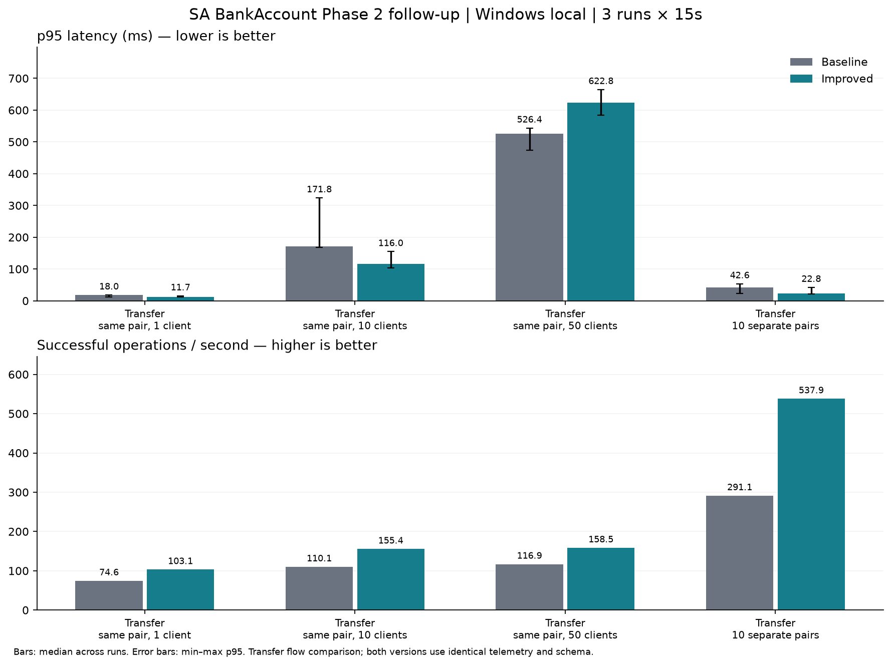

# Đánh giá đợt cải tiến tiếp theo của giai đoạn 2

## Phạm vi và thay đổi

1. Bổ sung đo thời gian bắt đầu transaction, callback, kết thúc và truy vấn khóa; đếm commit, lần thử bị từ chối, retry và hết retry. Dữ liệu là histogram/counter có kích thước cố định trong mỗi process, không chứa tài khoản, số tiền, key hay payload. Script chẩn đoán lấy snapshot qua IPC tại máy, không mở endpoint metrics công khai.
2. Chuyển khoản lấy khóa hai tài khoản bằng một SELECT có ORDER BY id ASC FOR UPDATE, thay cho hai SELECT nối tiếp. Giữ nguyên transaction, kiểm tra nghiệp vụ, retry, timeout và thứ tự khóa theo ID bất biến.
3. Nạp/rút nhận Idempotency-Key tùy chọn. Key được trim, dài 16–128 ký tự, phạm vi một tài khoản và dùng chung giữa nạp/rút. Cùng key/nội dung trả bút toán cũ với HTTP 200; khác loại/số tiền/mô tả trả 409. Không gửi key: mỗi request vẫn là giao dịch mới (201). Unique index và lưu key cùng bút toán/số dư bảo vệ tính nguyên tử. Replay kiểm tra quyền sở hữu và vẫn hoạt động sau khi đóng tài khoản. Không trả key trong response hay lịch sử.

## Phương pháp

Môi trường: AMD Ryzen AI 9 365 w/ Radeon 880M, 20 luồng logic, RAM 27.8 GiB; Node v24.11.1, PostgreSQL 15.19 (Debian 15.19-1.pgdg13+2) on x86_64-pc-linux-gnu, compiled by gcc (Debian 14.2.0-19) 14.2.0, 64-bit. Windows API và bộ tạo tải; PostgreSQL trong Docker tại cùng máy.
Mã API cải tiến: 87dd3ae89bd2c800b92b22665fbf7fc9130f5d4a; nguồn use case baseline: 8ad478154e3772eb60e08cc8a741b087843dd35f. Hash JS và kiểm tra UoW giống hệt được lưu trong environment.json.
Mỗi kịch bản đo 3 lần mỗi bản, 15 giây/lượt, warm-up 2 giây riêng; đảo thứ tự bản giữa các vòng. Dùng tải HTTP vòng kín không think-time. API/DB/bộ tạo tải dùng chung máy. p95 là trung vị của p95 từng lượt; không phải p95 gộp. Thời gian tại client gồm nhận và kiểm tra JSON, tính cả request lỗi.
Baseline dùng luồng chuyển khoản tại commit 8ad4781, được compile từ nguồn cố định. Hai bản dùng cùng UoW, telemetry, migration/index, client Prisma và bộ mã còn lại; chỉ thay use case chuyển khoản. Đây là phép đo tách riêng lợi ích gộp truy vấn khóa, không phải đo toàn bộ bản cũ trên schema cũ so với toàn bộ bản mới. Không đo hiệu năng nạp/rút trong bảng này.
Mỗi request chuyển 1 VND với key mới. Hot dùng một cặp tài khoản; distributed dùng 10 cặp độc lập. Trước mỗi lượt đặt lại fixture; sau lượt kiểm tra tổng tiền, số transfer, hai bút toán/transfer và số dư khớp sổ. SQL thống kê theo chênh lệch trước/sau, loại warm-up/reset/đối soát. Lấy mẫu pg_stat_activity mỗi khoảng 50 ms, không phải theo dõi liên tục. Không gộp với số liệu Kaggle cũ.

## Kết quả HTTP

| Kịch bản | p95 trước → sau (ms) | Giảm p95 | Thành công/giây trước → sau | Tăng thông lượng | Lỗi/request trước → sau |
|---|---:|---:|---:|---:|---:|
| transfer_hot_1 | 18.05 → 11.70 | 35.18% | 74.60 → 103.14 | 38.27% | 0/3650 → 0/4404 |
| transfer_hot_10 | 171.81 → 115.96 | 32.51% | 110.10 → 155.44 | 41.18% | 0/5105 → 0/6649 |
| transfer_hot_50 | 526.37 → 622.78 | -18.32% | 116.92 → 158.46 | 35.53% | 0/5315 → 0/7092 |
| transfer_distributed_10 | 42.62 → 22.77 | 46.57% | 291.13 → 537.91 | 84.77% | 0/15928 → 0/21223 |

Tổng 24 lượt, 69,366 request, 0 lỗi. 24/24 lượt đối soát đạt.

- transfer_hot_50: p95 tăng 18.32%; không kết luận mọi mức tải đều nhanh hơn.

## Chẩn đoán

| Kịch bản | Bắt đầu transaction TB trước → sau (ms) | Một truy vấn khóa TB trước → sau (ms) | Callback TB trước → sau (ms) | Số session chờ khóa TB trước → sau |
|---|---:|---:|---:|---:|
| transfer_hot_1 | 1.22 → 0.79 | 1.03 → 0.91 | 8.75 → 6.22 | 0.00 → 0.00 |
| transfer_hot_10 | 1.00 → 0.84 | 39.57 → 54.85 | 85.65 → 60.52 | 8.05 → 8.00 |
| transfer_hot_50 | 335.16 → 249.44 | 38.14 → 54.72 | 82.83 → 60.25 | 8.08 → 8.01 |
| transfer_distributed_10 | 3.45 → 1.77 | 2.46 → 1.75 | 22.03 → 12.01 | 0.00 → 0.00 |

Các ô TB là trung vị của trung bình từng lượt. Bắt đầu transaction gồm chờ pool, BEGIN và chi phí Prisma; không tách riêng chính xác thời gian chờ pool. Truy vấn khóa gồm chờ khóa, thực thi SQL và chi phí adapter. Bản trước có hai truy vấn khóa/attempt, bản sau có một: không so sánh trung bình một truy vấn như tổng thời gian giữ khóa. Callback bao gồm cả đọc và ghi; không phải phép đo chính xác thời gian giữ khóa.
Counter rejected là lần thử bị từ chối, không chứng minh rollback nếu lỗi mạng/commit không rõ kết quả. Retry chỉ thực hiện khi transaction được xác nhận hủy; histogram attempt không tính thời gian ngủ giữa hai lần thử. pg_stat_statements cung cấp thời gian ở server, khác độ trễ truy vấn nhìn từ ứng dụng.

| Kịch bản | Khoảng p95 trước → sau (ms) | Retry trước → sau | Số truy vấn khóa/attempt trước → sau |
|---|---:|---:|---:|
| transfer_hot_1 | 11.61–18.40 → 11.58–15.69 | 0 → 0 | 2.00 → 1.00 |
| transfer_hot_10 | 168.14–324.13 → 104.10–155.01 | 2 → 6 | 2.00 → 1.00 |
| transfer_hot_50 | 474.13–543.78 → 583.93–664.88 | 0 → 0 | 2.00 → 1.00 |
| transfer_distributed_10 | 23.17–53.72 → 21.81–42.38 | 0 → 0 | 2.00 → 1.00 |

## Kiểm chứng và giới hạn

Đạt 172 unit test + 46 integration test + 39 HTTP/persistence/retry/telemetry test = 257 test. Swagger contract đạt cho 10 API. Bản Docker build và smoke test đạt, gồm replay/conflict nạp/rút.
Kết quả build, unit, integration PostgreSQL thật, HTTP/persistence/retry/telemetry và Swagger được lưu tại results/validation.txt. Kiểm thử gồm gửi 20 yêu cầu nạp/rút cùng key đồng thời, xung đột loại/số tiền/mô tả, quyền sở hữu, key theo tài khoản, replay sau đóng tài khoản, rollback sau ghi ledger, hết timeout sau ghi ledger, mất socket sau commit và chuyển khoản vòng ba tài khoản trộn nạp/rút. Một kiểm thử giữ khóa bằng connection riêng để xác nhận telemetry đo được truy vấn thực sự bị chặn.
Đây là đo ngắn hạn trên một máy, chưa xác định tải tối đa, chưa soak dài hạn hoặc nhiều replica API. Chưa đánh giá chi phí ghi/dung lượng của index idempotency trên dữ liệu lớn. Key được giữ cùng bút toán, chưa có chính sách hết hạn; yêu cầu thiếu key vẫn có thể bị lặp nếu client tự gửi lại. Chưa hứa hẹn loại bỏ mọi lỗi hoặc giảm mọi phân vị độ trễ.
Các lượt có độ dao động đáng kể, đặc biệt kịch bản các cặp độc lập; chưa cố định xung CPU hay tách bộ tạo tải/DB ra máy riêng. Warm-up 2 giây chưa bảo đảm mọi cache/JIT ở trạng thái ổn định. Phần trăm ở bảng chỉ mô tả bộ đo này, chưa phải ước lượng có kiểm định thống kê cho môi trường khác.

## Cảnh báo dependency hiện có

npm audit --omit=dev báo 9 package bị đánh dấu (7 high, 2 moderate, 0 critical). Đợt cải tiến này không thay package-lock.json và chưa nâng các dependency đó. Đây là cảnh báo theo cây dependency, chưa phải kết luận từng lỗ hổng khai thác được qua API PostgreSQL hiện tại. Cần xử lý và kiểm thử riêng trước triển khai thực tế. [Bản audit gốc](results/dependency-audit.json).

## Dữ liệu khảo sát được giữ lại

Bộ đo khảo sát đầu tiên được giữ ở exploratory-sampling-alias: một lỗi tên alias làm các trường lấy mẫu khóa thành null. Không dùng các trường đó để kết luận; bộ đo chính thức sửa alias và kiểm tra giá trị hợp lệ. Các số đo HTTP/telemetry khảo sát cũng được giữ nguyên, gồm lỗi 503 đã quan sát.

Bộ exploratory-baseline-setup bị dừng khi phát hiện helper compile baseline sai rootDir và UoW chưa được copy lại sau build. Đã sửa helper và bắt buộc UoW hai bản cùng hash; dữ liệu gián đoạn không dùng để kết luận.

[Hướng dẫn chạy lại và hợp đồng API](README.md) · [Dữ liệu từng lượt](results/runs.json) · [Môi trường](results/environment.json) · [Tổng hợp](results/summary.json)
