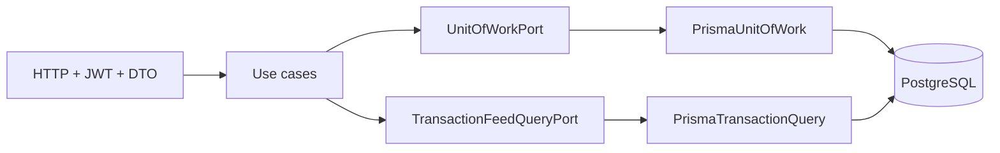

# Thiết kế cải tiến giai đoạn 2

## Mục tiêu chất lượng

| Tình huống | Điều cần đánh giá | Cách kiểm chứng |
|---|---|---|
| Nhiều yêu cầu chuyển khoản đồng thời | Thông lượng, độ trễ và lỗi do cạnh tranh khóa | Chuyển trên một cặp tài khoản và trên các cặp độc lập; đo p50/p95/p99, số thành công/giây và tỷ lệ lỗi |
| Client gửi lại cùng key với payload khác | Khả năng phát hiện xung đột yêu cầu | HTTP 409, một transfer và hai bút toán, số dư chỉ thay đổi một lần |
| Transaction hết hạn sau khi đã ghi dữ liệu | Rollback và giới hạn thử lại | Chèn độ trễ vượt timeout trong test PostgreSQL; xác nhận rollback trước khi thực hiện lại |
| Duyệt lịch sử ở vị trí sâu khi dữ liệu tăng | Chi phí bỏ qua dữ liệu và COUNT | So sánh cùng 20 ID ở vị trí 80% lịch sử với 10.000/300.000 bản ghi; kiểm tra EXPLAIN ANALYZE BUFFERS |

## Ranh giới kiến trúc

Hệ thống tiếp tục là modular monolith với các module identity, accounts và money-movement. Domain/application giữ giao tiếp qua port; PostgreSQL/Prisma và HTTP nằm trong adapter. Chuyển khoản vẫn dùng một database transaction để giữ tính nguyên tử của số dư và sổ giao dịch.

## Luồng ghi

Trước: tìm tài khoản đích → khóa hai tài khoản theo ID tăng dần → kiểm tra nghiệp vụ/key → cập nhật hai số dư bằng hai lệnh → tạo transfer → tạo hai bút toán bằng hai lệnh.

Sau: giữ phần đọc/khóa/kiểm tra, gộp hai cập nhật số dư thành một UPDATE FROM VALUES và hai bút toán thành một createMany. Tất cả vẫn ở trong transaction. Các tham số SQL đi qua Prisma.sql; không nối dữ liệu đầu vào thành câu lệnh. Lỗi ràng buộc phải rollback, không dùng skipDuplicates.

Cùng tài khoản nguồn/key chỉ được replay khi đích, số tiền và mô tả trùng với lệnh đã hoàn tất. Kiểm tra chủ tài khoản diễn ra trước khi trả kết quả cũ. Replay vẫn dùng được sau khi tài khoản đóng, phù hợp hành vi cũ.

Unit of Work thử lại tối đa một lần sau khi Prisma xác nhận transaction bị hủy (P2034 hoặc P2028 có thông báo hết hạn). Giữ timeout 5 giây; thêm jitter ngắn giữa hai lần. Không thử lại lỗi mạng hoặc commit không rõ kết quả. Nếu cả hai lần đều thất bại trả 503 TRANSACTION_BUSY. Callback chỉ thực hiện các tác động trong database transaction; không đặt gửi email, gọi dịch vụ ngoài hay các tác động không rollback được trong callback này.

Adapter cũng chuyển Decimal thành chuỗi thật theo hợp đồng port, thay vì ép kiểu TypeScript mà giữ nguyên đối tượng Decimal ở runtime.

## Luồng đọc

API cũ dùng page/limit, COUNT tổng số dòng và OFFSET. API mới `/accounts/{accountId}/transactions/feed` dùng cursor là ID cuối trang, seek theo cặp `(created_at, id)` và đọc thêm một dòng để biết còn trang tiếp hay không. Dùng index sẵn có `(account_id, created_at DESC, id DESC)`.

Timestamp của cursor được tra trong PostgreSQL. Cách này giữ microsecond khi nhiều bản ghi khác thời gian nhưng JavaScript Date biểu diễn thành cùng millisecond. ID là tiêu chí phụ khi timestamp trùng nhau. Mỗi trang vẫn kiểm tra quyền sở hữu; cursor chỉ hợp lệ trong tài khoản và bộ lọc đang dùng.

## Đánh đổi và giới hạn

- Cursor phù hợp duyệt lần lượt; không trả exact total và không nhảy trực tiếp tới trang N. API cũ vẫn phục vụ nhu cầu này. Thí nghiệm trang sâu giả định client đã có cursor từ trang trước.
- Ghi theo lô giảm số lượt gọi database, nhưng p95/p99 có thể chịu tác động của cạnh tranh khóa. Kết luận phải đọc cùng thông lượng, tỷ lệ lỗi và độ dao động, không chỉ lấy một chỉ số thuận lợi.
- Thử lại giúp xử lý transaction bị hủy tạm thời nhưng có thể làm request chậm hơn và tạo thêm tải. Hai lần thử là giới hạn; 503 cho phép client quyết định thử lại về sau. Cơ chế này không tạo ra cam kết mọi mức tải đều thành công.
- Việc duyệt qua nhiều request không phải một snapshot database duy nhất. Bản ghi mới hơn cursor không chen vào trang sau; dữ liệu sửa/xóa hoặc chèn lùi thời gian cần được hiểu theo trạng thái hiện tại.
- Không thêm schema/index hoặc dịch vụ mới trong lần cải tiến này. Tác động số đo được đánh giá trên cùng schema, phần cứng và dữ liệu trong từng môi trường.
