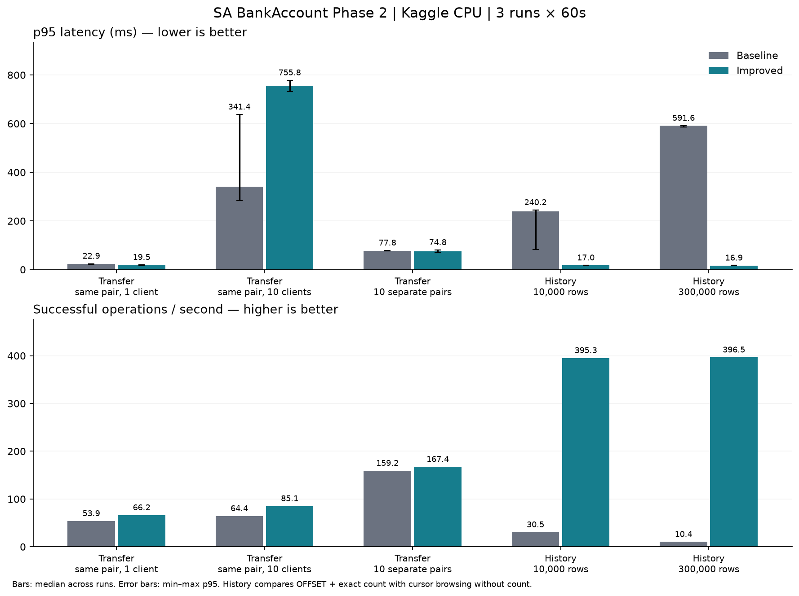

# Đánh giá cải tiến SA_BankAccount — Giai đoạn 2

## Phạm vi và môi trường

Đã chạy thực nghiệm trên **Kaggle CPU**; hai phiên bản cùng một phiên phần cứng. Kết quả tại máy Windows được giữ riêng.

- Commit gốc: `c347c921d77ba533cfacd8e180feccef720be013`.
- Thời điểm bắt đầu (UTC): 2026-11-17T06:32:23.924Z.
- CPU: Intel(R) Xeon(R) CPU @ 2.20GHz, 4 luồng logic; RAM 31.3 GiB.
- Node v24.22.0; linux 6.18.55+; PostgreSQL 16.15 (Ubuntu 16.15-0ubuntu0.24.04.1) on x86_64-pc-linux-gnu, compiled by gcc (Ubuntu 13.3.0-6ubuntu2~24.04.1) 13.3.0, 64-bit. API, PostgreSQL và bộ tạo tải cùng phiên Kaggle CPU.
- Không nâng phần cứng, không thay schema/index, không giảm Bcrypt. API, PostgreSQL và bộ tạo tải dùng chung máy. Không đo đăng nhập trong thí nghiệm này; token được chuẩn bị trước.

## Những thay đổi đã thực hiện

1. **Rút ngắn phần ghi của chuyển khoản:** giữ khóa dòng theo thứ tự và một transaction, gộp hai UPDATE số dư thành một câu lệnh và hai INSERT bút toán thành một createMany. Phần ghi giảm từ 5 xuống 3 lần gọi database (không tính SELECT và BEGIN/COMMIT). Không bỏ kiểm tra số dư, quyền sở hữu, trạng thái hay ràng buộc database.
2. **Chống dùng lại khóa với payload khác:** cùng tài khoản nguồn và key nhưng khác số tiền, tài khoản đích hoặc mô tả trả HTTP 409 IDEMPOTENCY_KEY_REUSED. Gửi lại đúng lệnh trả kết quả cũ. Đây là thay đổi về độ tin cậy, không gộp vào tuyên bố tăng tốc riêng của batching.
3. **API lịch sử dùng cursor:** bổ sung GET /api/v1/accounts/{accountId}/transactions/feed. Dùng index có sẵn (account_id, created_at DESC, id DESC), lấy limit+1 dòng để xác định hasMore và không COUNT mỗi trang. API page/limit cũ được giữ nguyên.
4. **Thử lại có giới hạn khi transaction bị hủy:** phát hiện timeout transaction khi cạnh tranh khóa. Chỉ tự thử lại một lần với lỗi Prisma P2034 hoặc P2028 xác nhận transaction đã hết hạn; giữ timeout gốc 5 giây. Không tự thử lại lỗi mạng/commit không rõ trạng thái, lỗi ràng buộc hay lỗi nghiệp vụ. Nếu vẫn thất bại trả 503 TRANSACTION_BUSY. Việc thử lại có thể tăng thời gian ở đuôi; không coi p95 là toàn bộ trải nghiệm.

Cursor là ID giao dịch cuối trang. Timestamp được đọc ngay trong PostgreSQL để giữ chính xác microsecond; mọi trang đều kiểm tra chủ tài khoản. Cursor phải thuộc cùng tài khoản và bộ lọc. Trang cuối có nextCursor=null. Nếu bản ghi cursor bị xóa, yêu cầu nhận 400 và client cần bắt đầu lại.

## Thiết kế phép đo

Mỗi kịch bản chạy 3 lần cho mỗi bản, 60 giây/lượt, warm-up 2 giây riêng. Thứ tự bản gốc/cải tiến được đảo giữa các vòng. Dùng HTTP thực, tải vòng kín không think-time; số client là số luồng yêu cầu đồng thời, không phải requests/giây. Độ trễ tại client gồm nhận response, đọc JSON và kiểm tra kết quả. Bộ tạo tải dùng Node.js, không dùng k6; không so sánh trực tiếp với số liệu k6 của nhóm gốc. p95 ở bảng là trung vị của p95 từng lượt; không phải p95 gộp toàn bộ request.

- transfer_hot_1/10: 1 hoặc 10 client chuyển 1 VND trên cùng cặp tài khoản, mỗi request có key mới.
- transfer_distributed_10: 10 client trên 10 cặp tài khoản độc lập.
- history_10000_deep: 10.000 bản ghi/tài khoản, đọc 20 dòng ở vị trí OFFSET 8.000.
- history_300000_deep: 300.000 bản ghi/tài khoản, đọc 20 dòng ở vị trí OFFSET 240.000.
- Bản gốc đọc trang bằng OFFSET + COUNT; bản cải tiến dùng cursor đã biết để đọc **cùng 20 ID**, và script kiểm tra toàn bộ ID trả về. Thời gian lấy cursor ban đầu không nằm trong phép đo trang sâu.
- Trước mỗi lượt ghi đặt lại cùng số dư, xóa dữ liệu chỉ trong fixture của lần chạy. Sau mỗi lượt đối soát tổng tiền, số transfer, đúng hai bút toán/transfer và số dư từng tài khoản khớp sổ giao dịch.

**Đánh đổi của cursor:** không trả tổng số dòng/trang và không hỗ trợ nhảy trực tiếp tới trang số N. Kết quả lịch sử đo lợi ích của cách duyệt tuần tự mới, bao gồm việc bỏ COUNT; không phải tăng tốc cùng một hợp đồng API hoàn toàn giống nhau. Đo EXPLAIN riêng ở dưới để tách chi phí OFFSET.

## Kết quả HTTP trước–sau

| Kịch bản | p95 gốc (ms) | p95 mới (ms) | Giảm p95 | Gốc (thành công/s) | Mới (thành công/s) | Tăng thông lượng |
|---|---:|---:|---:|---:|---:|---:|
| transfer_hot_1 | 22.89 | 19.47 | 14.93% | 53.91 | 66.21 | 22.82% |
| transfer_hot_10 | 341.36 | 755.79 | -121.41% | 64.37 | 85.13 | 32.24% |
| transfer_distributed_10 | 77.84 | 74.75 | 3.97% | 159.18 | 167.45 | 5.20% |
| history_10000_deep | 240.16 | 17.02 | 92.91% | 30.51 | 395.27 | 1195.70% |
| history_300000_deep | 591.60 | 16.94 | 97.14% | 10.40 | 396.49 | 3712.96% |

### Diễn giải

Lịch sử dùng cursor được đánh giá cho nhu cầu duyệt tuần tự. Luồng ghi được đánh giá theo cả thông lượng và độ trễ; giảm số lượt gọi SQL không bảo đảm mọi phân vị đều giảm.

- transfer_hot_10: p95 tăng 121.41%; thông lượng tăng 32.24%. Không kết luận cải thiện đồng đều; xem độ dao động ở bảng dưới.

Tổng 30 lượt đo, 260,527 request; 0 request lỗi. Toàn bộ 18 lượt ghi vượt qua đối soát dữ liệu.

| Kịch bản | Lỗi / request gốc | Lỗi / request mới |
|---|---:|---:|
| transfer_hot_1 | 0/9603 | 0/11939 |
| transfer_hot_10 | 0/11681 | 0/14980 |
| transfer_distributed_10 | 0/28567 | 0/30428 |
| history_10000_deep | 0/8317 | 0/71328 |
| history_300000_deep | 0/1879 | 0/71805 |

Nhóm đã phát hiện timeout transaction trong đợt khảo sát tại máy và bổ sung thử lại có giới hạn trước phép đo này. Không sửa bản gốc để che lỗi. Log lỗi của các lượt đo chính thức được lưu cùng runs.json nếu có.

## Độ dao động và tài nguyên API

| Kịch bản | Khoảng p95 gốc (ms) | Khoảng p95 mới (ms) | CPU gốc / mới (%) | RSS gốc / mới (MiB) |
|---|---:|---:|---:|---:|
| transfer_hot_1 | 22.04–24.35 | 17.68–19.72 | 64.74 / 57.21 | 440.65 / 396.26 |
| transfer_hot_10 | 283.19–638.03 | 731.45–778.48 | 69.05 / 61.23 | 450.99 / 408.45 |
| transfer_distributed_10 | 76.83–79.05 | 68.84–80.65 | 106.46 / 104.71 | 449.00 / 409.37 |
| history_10000_deep | 82.24–245.02 | 16.28–17.60 | 15.69 / 106.39 | 450.29 / 410.40 |
| history_300000_deep | 585.25–591.92 | 15.79–17.12 | 5.44 / 104.25 | 450.30 / 410.40 |

CPU lấy chênh lệch thời gian CPU của tiến trình API ở hai đầu mỗi lượt, RSS là mẫu cuối lượt; 100% tương đương một lõi logic. Đây là số liệu phụ trợ gần đúng, có chi phí lấy mẫu ngoài cửa sổ HTTP; không phải tổng CPU/RAM toàn hệ thống và chưa đo peak theo từng kịch bản. Peak RSS của tiến trình có trong dữ liệu thô nhưng bao gồm các kịch bản trước đó.

## Bằng chứng ở database

EXPLAIN ANALYZE BUFFERS trên cùng trang sâu 300.000 bản ghi, không kèm COUNT:

- OFFSET: index scan đọc 240.020 dòng để trả 20; execution time 60.326 ms; 10222 shared-buffer hits.
- Seek: index chính đọc 21 dòng và một lookup cursor; execution time 0.08 ms; 9 shared-buffer hits, 0 shared-buffer reads.
- Hai bản đều dùng index đã có; không thêm index chỉ để làm đẹp số đo. Đây là một mẫu kế hoạch truy vấn, không phải thống kê thời gian SQL qua nhiều lần.

## Kiểm thử và giới hạn

Kết quả kiểm thử được lưu riêng trong results/validation.txt. Bộ kiểm thử mới sử dụng PostgreSQL thật: gửi lại đồng thời, payload xung đột, chuyển chéo, chống thấu chi, lỗi sau khi đã ghi dữ liệu, lỗi ràng buộc khi ghi theo lô; cursor có timestamp trùng và khác nhau ở microsecond, phân quyền, bộ lọc và chèn bản ghi giữa hai trang. Kiểm thử HTTP xác nhận DTO/Guard/envelope và API cũ.

Đạt 172 unit test, 46 integration test và 22 test HTTP/persistence/retry, tổng cộng 240 test. Swagger contract cũng đạt cho 10 API. Adapter chuẩn hóa Decimal thành chuỗi thật theo hợp đồng port; test integration đã kiểm chứng kiểu dữ liệu trả về. Kết quả Docker được ghi riêng ở bộ dữ liệu tại máy.

Chưa xác định tải tối đa, chưa kiểm thử soak dài hạn, chưa kiểm chứng nhiều bản sao API hoặc mô hình multi-node. Dữ liệu lịch sử được sinh tổng hợp để đo truy vấn; không coi là sổ giao dịch tài chính đã đối soát. Mỗi lượt chính thức chỉ 60 giây nên kết luận giới hạn trong cấu hình và kịch bản đã đo. Không suy rộng thành cam kết hiệu năng production.

Hướng dẫn chạy lại: [README](README.md). Dữ liệu thô: [runs.json](results/runs.json), [môi trường](results/environment.json), [summary.json](results/summary.json), [OFFSET](results/plan-offset.json), [seek](results/plan-seek.json).
